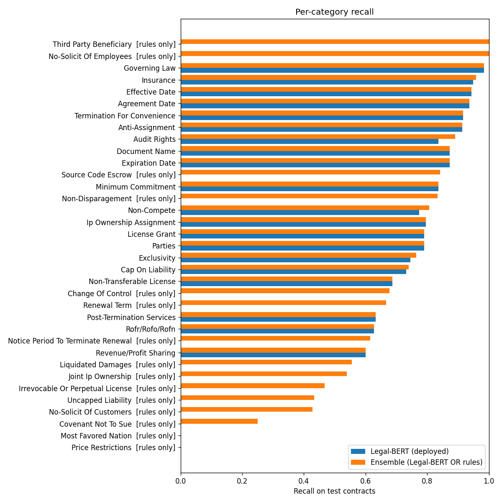
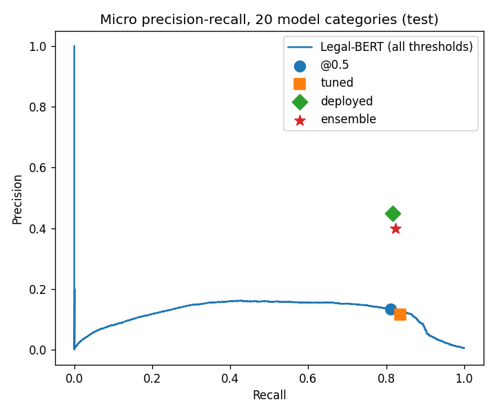

# Legal Document Summariser: Project Report (auto-generated draft)

## 1. Problem
Long legal contracts hide clauses a signer must know about (auto-renewal, one-sided termination, liability caps,
indemnities, non-competes, ...). Missing one is costly, so the system is designed for **high recall** on important
clauses, and it presents them **verbatim** next to a readable abstractive summary.

## 2. System
1. **Ingestion & structure (classical NLP):** pdfplumber/PyMuPDF text extraction; regex heading detection with a context check
   (a heading must start a new block, so wrapped lines of ALL-CAPS clauses are not mistaken for headings); a legal-aware sentence
   splitter that protects abbreviations ("Sec.", "Inc.") and clause numbers ("3.2.1").
2. **Rule layer (classical NLP):** 29 regex risk categories (132 patterns), developed on the CUAD
   train contracts and checked on the validation contracts. 23 CUAD categories are covered by a rule.
3. **Fine-tuned Legal-BERT (DL):** `nlpaueb/legal-bert-base-uncased` fine-tuned end-to-end on CUAD for multi-label classification over
   the 20 most frequent clause categories; 3 epochs, lr 2e-05, max length 256,
   weighted BCE + negative down-sampling (ratio 2.0); per-category thresholds tuned for F2 on validation contracts.
   Trained on GPU (cuda). It was trained on the first version of the clause table, whose "Parties" labels were
   noisy, so the pipeline keeps its Parties flag only in a document's first 5 clauses (Section 4.4).
4. **Ensemble:** a clause is surfaced if the rules **or** Legal-BERT flag it. Rule names are mapped to CUAD names so a clause caught
   by both detectors appears once, credited to both.
5. **Abstractive summarisation (DL):** `facebook/bart-large-cnn`, section-wise with sentence-boundary chunking, then an overall summary.

## 3. Data
- **CUAD v1**: 510 commercial contracts, 41 lawyer-annotated clause categories. Split **by contract** 70/15/15
  (357/76/77 contracts) to avoid leakage. Evaluated against labels derived
  from the answers' character offsets (15,004 test clauses).
- **BillSum** (test split, 50 documents) for summarisation ROUGE.
- **Synthetic contracts:** 3 PDFs (NDA, residential lease, SaaS terms) with planted clauses and an answer key, for an end-to-end check.
- 0 real-world contracts for qualitative testing.

## 4. Results
### 4.1 Clause detection: the 20 categories the model learned (test contracts)
| system | macro P | macro R | macro F1 | micro P | micro R | micro F1 |
|---|---|---|---|---|---|---|
| Legal-BERT @0.5 | 0.510 | 0.800 | 0.596 | 0.133 | 0.812 | 0.228 |
| Legal-BERT tuned | 0.471 | 0.822 | 0.568 | 0.115 | 0.836 | 0.203 |
| Legal-BERT deployed | 0.492 | 0.812 | 0.594 | 0.448 | 0.816 | 0.579 |
| Ensemble | 0.439 | 0.818 | 0.552 | 0.399 | 0.823 | 0.537 |

### 4.2 The 8 categories with both a rule and a model head (rules vs model)
| system | macro P | macro R | macro F1 | micro P | micro R | micro F1 |
|---|---|---|---|---|---|---|
| Rules | 0.435 | 0.487 | 0.442 | 0.423 | 0.544 | 0.476 |
| Legal-BERT @0.5 | 0.568 | 0.815 | 0.657 | 0.597 | 0.822 | 0.692 |
| Legal-BERT tuned | 0.540 | 0.833 | 0.645 | 0.575 | 0.839 | 0.683 |
| Legal-BERT deployed | 0.540 | 0.833 | 0.645 | 0.575 | 0.839 | 0.683 |
| Ensemble | 0.409 | 0.848 | 0.540 | 0.413 | 0.857 | 0.558 |

### 4.3 All 35 evaluated categories, including the 15 only the rules cover
| system | macro P | macro R | macro F1 | micro P | micro R | micro F1 |
|---|---|---|---|---|---|---|
| Rules | 0.232 | 0.349 | 0.255 | 0.383 | 0.260 | 0.310 |
| Legal-BERT deployed | 0.281 | 0.464 | 0.339 | 0.448 | 0.723 | 0.553 |
| Ensemble | 0.384 | 0.705 | 0.470 | 0.388 | 0.798 | 0.522 |

### 4.4 Parties filter
| Parties flags | flagged | precision | recall |
|---|---|---|---|
| raw model (threshold 0.05) | 8787 | 0.018 | 0.987 |
| deployed (first 5 clauses of a document) | 288 | 0.431 | 0.790 |

### 4.5 Headline: important clauses surfaced
| metric | value |
|---|---|
| important clauses (any CUAD label) | 1,524 |
| surfaced by ensemble, as deployed (any label) | 80.3% |
| surfaced by ensemble (labels in a category some detector covers) | 84.1% |
| surfaced, ignoring Parties flags (clauses with a non-Parties label) | 80.3% |
| surfaced by rules alone (any label) | 35.5% |
| surfaced by Legal-BERT alone, deployed (any label) | 73.7% |
| share of ALL clauses flagged (reading load), as deployed | 21.8% |
| share of ALL clauses flagged with raw Parties flags (for comparison) | 63.8% |

### 4.6 Per-category recall
| category | detector | support | R Rules | R Legal-BERT | R Ensemble | P Ensemble |
|---|---|---|---|---|---|---|
| Price Restrictions | rules only | 0 | 0.000 |  | 0.000 | 0.000 |
| Most Favored Nation | rules only | 4 | 0.000 |  | 0.000 | 0.000 |
| Covenant Not To Sue | rules only | 12 | 0.250 |  | 0.250 | 0.115 |
| No-Solicit Of Customers | rules only | 7 | 0.429 |  | 0.429 | 0.250 |
| Uncapped Liability | rules only | 30 | 0.433 |  | 0.433 | 0.351 |
| Irrevocable Or Perpetual License | rules only | 15 | 0.467 |  | 0.467 | 1.000 |
| Joint Ip Ownership | rules only | 13 | 0.538 |  | 0.538 | 0.350 |
| Liquidated Damages | rules only | 9 | 0.556 |  | 0.556 | 0.294 |
| Revenue/Profit Sharing | Legal-BERT | 85 |  | 0.600 | 0.600 | 0.486 |
| Notice Period To Terminate Renewal | rules only | 13 | 0.615 |  | 0.615 | 0.471 |
| Rofr/Rofo/Rofn | Legal-BERT | 43 |  | 0.628 | 0.628 | 0.397 |
| Post-Termination Services | Legal-BERT | 60 |  | 0.633 | 0.633 | 0.286 |
| Renewal Term | rules only | 27 | 0.667 |  | 0.667 | 0.450 |
| Change Of Control | rules only | 31 | 0.677 |  | 0.677 | 0.231 |
| Non-Transferable License | Legal-BERT | 67 |  | 0.687 | 0.687 | 0.511 |
| Cap On Liability | Legal-BERT + rules | 127 | 0.346 | 0.732 | 0.740 | 0.534 |
| Exclusivity | Legal-BERT + rules | 51 | 0.275 | 0.745 | 0.765 | 0.181 |
| Parties | Legal-BERT | 157 |  | 0.790 | 0.790 | 0.431 |
| License Grant | Legal-BERT | 119 |  | 0.790 | 0.790 | 0.595 |
| Ip Ownership Assignment | Legal-BERT + rules | 39 | 0.385 | 0.795 | 0.795 | 0.341 |
| Non-Compete | Legal-BERT + rules | 31 | 0.419 | 0.774 | 0.806 | 0.269 |
| Non-Disparagement | rules only | 12 | 0.833 |  | 0.833 | 0.400 |
| Minimum Commitment | Legal-BERT | 49 |  | 0.837 | 0.837 | 0.410 |
| Source Code Escrow | rules only | 19 | 0.842 |  | 0.842 | 0.320 |
| Expiration Date | Legal-BERT | 71 |  | 0.873 | 0.873 | 0.738 |
| Document Name | Legal-BERT | 79 |  | 0.873 | 0.873 | 0.324 |
| Audit Rights | Legal-BERT + rules | 128 | 0.617 | 0.836 | 0.891 | 0.424 |
| Anti-Assignment | Legal-BERT + rules | 93 | 0.624 | 0.914 | 0.914 | 0.607 |
| Termination For Convenience | Legal-BERT + rules | 36 | 0.361 | 0.917 | 0.917 | 0.418 |
| Agreement Date | Legal-BERT | 78 |  | 0.936 | 0.936 | 0.230 |
| Effective Date | Legal-BERT | 71 |  | 0.944 | 0.944 | 0.211 |
| Insurance | Legal-BERT + rules | 118 | 0.873 | 0.949 | 0.958 | 0.496 |
| Governing Law | Legal-BERT | 65 |  | 0.985 | 0.985 | 0.901 |
| No-Solicit Of Employees | rules only | 7 | 1.000 |  | 1.000 | 0.241 |
| Third Party Beneficiary | rules only | 4 | 1.000 |  | 1.000 | 0.167 |

### 4.7 Summarisation (BillSum, ROUGE F1)
| system | ROUGE-1 | ROUGE-2 | ROUGE-L | sec/doc |
|---|---|---|---|---|
| Lead-3 baseline | 0.213 | 0.124 | 0.153 | 0.000 |
| facebook/bart-large-cnn (chunked) | 0.403 | 0.191 | 0.253 | 0.000 |

### 4.8 End-to-end test on contracts
Synthetic contracts scored against the answer key:

| contract | planted clauses | caught | right category | benign clauses | false alarms | not found (splitting problem) | catch rate | right-category rate |
|---|---|---|---|---|---|---|---|---|
| synthetic_mutual_nda.pdf | 13 | 12 | 12 | 2 | 0 | 0 | 0.923 | 0.923 |
| synthetic_residential_lease.pdf | 16 | 15 | 14 | 3 | 1 | 0 | 0.938 | 0.875 |
| synthetic_saas_terms.pdf | 19 | 18 | 17 | 3 | 0 | 0 | 0.947 | 0.895 |
| TOTAL | 48 | 45 | 43 | 8 | 1 | 0 | 0.938 | 0.896 |

| contract | clauses | sections | flagged | rules only | Legal-BERT only | both | seconds |
|---|---|---|---|---|---|---|---|
| synthetic_mutual_nda.pdf | 19 | 9 | 13 | 6 | 2 | 5 | 14.400 |
| synthetic_residential_lease.pdf | 20 | 8 | 16 | 6 | 5 | 5 | 14.400 |
| synthetic_saas_terms.pdf | 22 | 8 | 18 | 5 | 6 | 7 | 11.800 |

### 4.9 Training history
| epoch | train_loss | val_precision | val_recall | val_f1 | val_f2 | minutes |
|---|---|---|---|---|---|---|
| 1 | 0.175 | 0.502 | 0.742 | 0.585 | 0.663 | 8.753 |
| 2 | 0.054 | 0.496 | 0.808 | 0.602 | 0.704 | 8.536 |
| 3 | 0.036 | 0.556 | 0.778 | 0.637 | 0.710 | 8.693 |

## 5. Error analysis (fill in from Part 5, Section 2)
- Weakest categories with at least 5 test clauses: Covenant Not To Sue (R 0.25, rules only), No-Solicit Of Customers (R 0.43, rules only), Uncapped Liability (R 0.43, rules only).
- Rules-only categories (15) have mean recall 0.55, against
  0.82 where Legal-BERT has a head: retraining on all 41 categories is the main fix.
- Miss rate by clause length (evaluation §2b; clauses are truncated at 256 tokens):

| bucket | labels | missed | miss rate |
|---|---|---|---|
| <=15 | 107 | 50 | 0.467 |
| 16-30 | 385 | 81 | 0.210 |
| 31-60 | 670 | 116 | 0.173 |
| 61-120 | 453 | 77 | 0.170 |
| >120 | 155 | 34 | 0.219 |

- Many high-confidence "false positives" are relevant clauses CUAD simply didn't highlight (label noise).

## 6. Design decisions & limitations
- Extractive red flags + abstractive summary, so a summariser can never silently drop a risky clause.
- Rules cover CUAD categories the classifier has no head for; the classifier catches paraphrases the rules miss.
- The classifier was trained on noisy Parties labels and only the top 20 categories (no GPU access to retrain).
- `facebook/bart-large-cnn` is trained on news, not contracts (domain gap; see ROUGE vs Lead-3).
- Heading detection is heuristic and template-dependent; scanned PDFs need OCR first.
- Not legal advice.

## 7. Future work
Retrain Legal-BERT on the corrected labels and all 41 categories; legal-domain summariser (e.g. fine-tune on contract summaries);
longer-context classifier (Longformer / sliding window); OCR support.
